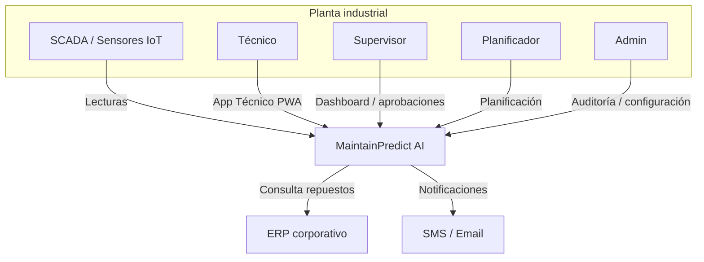
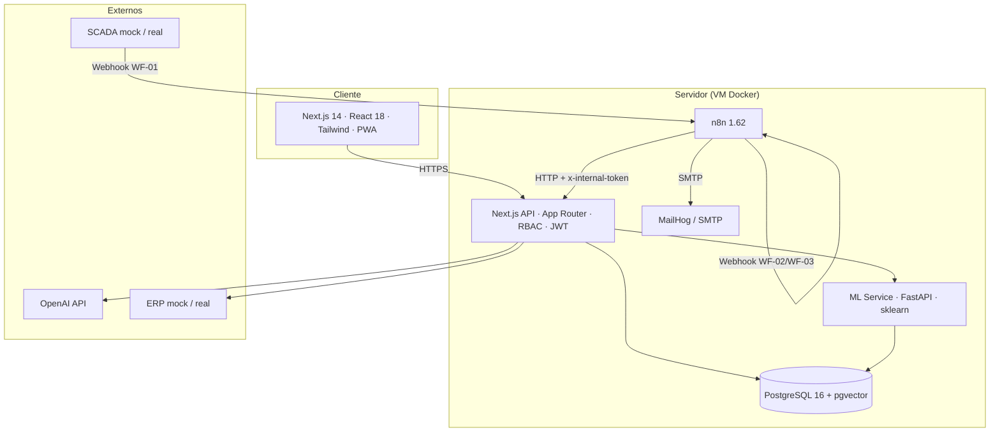
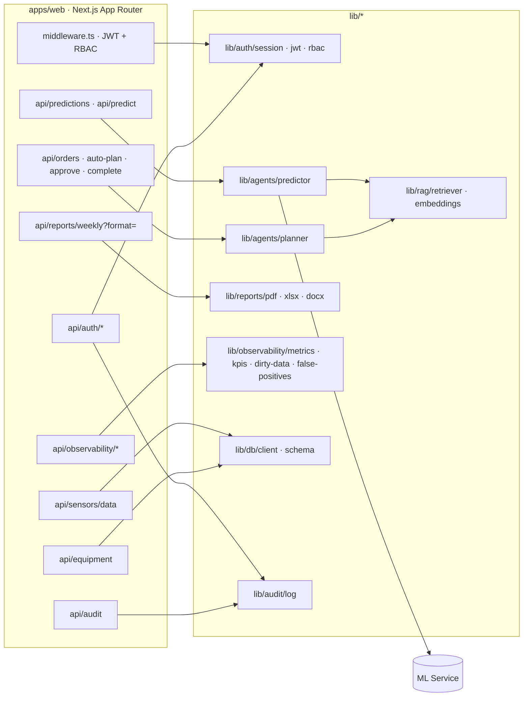
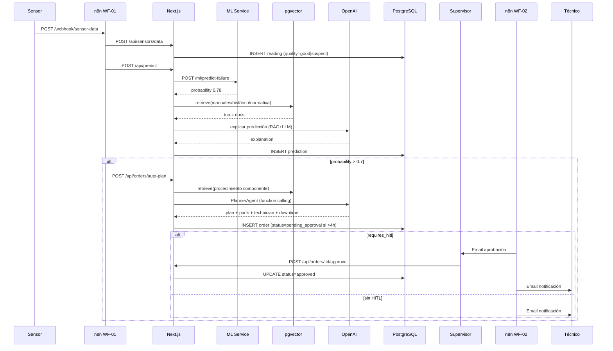
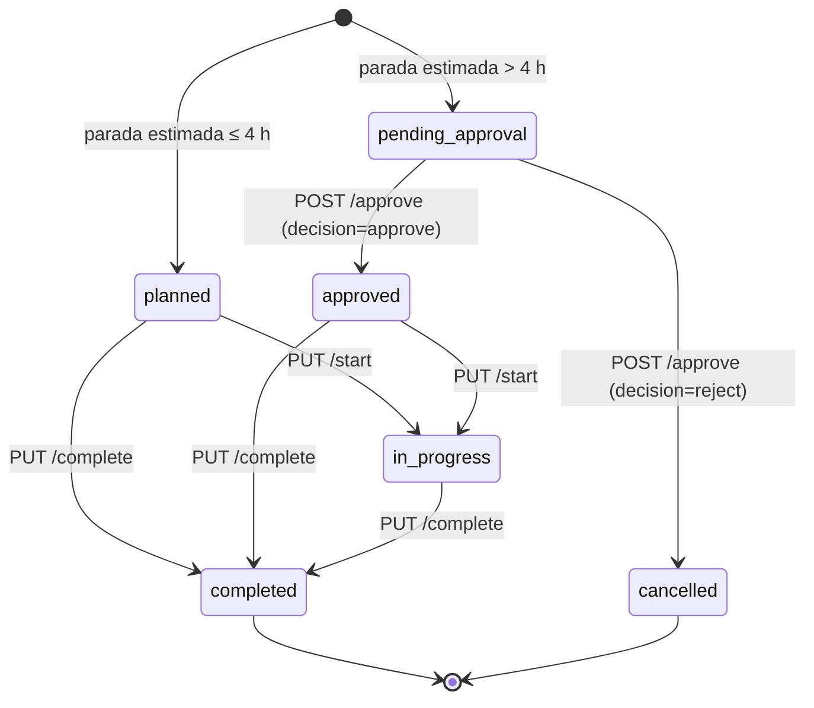
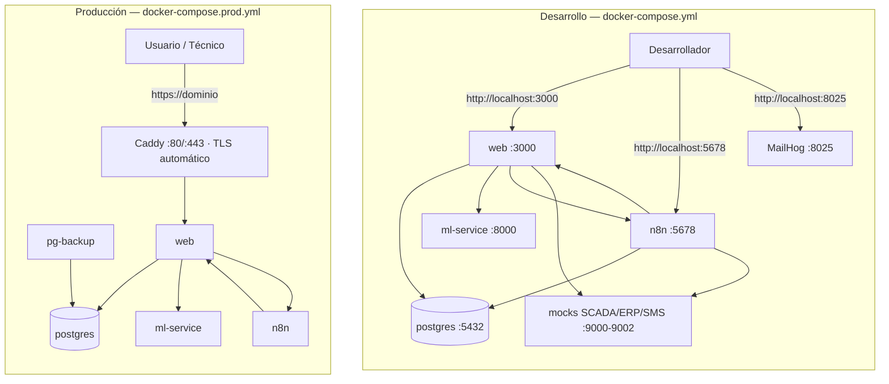

# Arquitectura — MaintainPredict AI

## 1. Visión general

MaintainPredict AI predice fallas en equipos industriales con 7 días de
anticipación y genera órdenes de mantenimiento óptimas de forma
automática. La plataforma combina **sensores IoT**, **orquestación de
workflows (n8n)**, **agentes IA (PredictorAgent + PlannerAgent)**,
**RAG sobre base de conocimiento** y **PostgreSQL + pgvector**.

**Decisión de arquitectura: D (Agéntica)** — justificada porque el
problema requiere:

- Predicción ML contextual (LSTM/RandomForest) sobre series temporales.
- Planificación contextual con reglas de negocio (producción, repuestos,
  técnicos, HITL).
- Explicabilidad y trazabilidad de cada decisión.
- RAG sobre manuales, histórico y normativa.

## 2. Diagrama C4 — Contexto

## 3. Diagrama C4 — Contenedores

## 4. Diagrama C4 — Componentes (API Next.js)

## 5. Flujo end-to-end (WF-01 → WF-02 → HITL)

## 6. Justificación de decisiones

| Decisión | Alternativa | Motivo |
|---|---|---|
| Arquitectura D (agéntica) | A (monolito), B (microservicios), C (serverless) | Requiere razonamiento contextual + RAG + planificación |
| Next.js App Router | NestJS / Fastify | Un único despliegue para frontend + API; streaming nativo |
| Drizzle ORM | Prisma | Más ligero, tipado SQL-first, soporte nativo pgvector |
| pgvector | Pinecone / Weaviate | Co-ubicado con datos relacionales; sin coste extra |
| n8n self-hosted | Temporal / Airflow | Bajo acoplamiento, low-code, workflows exportables |
| ML service separado (FastAPI) | Todo en Next.js | Mejor ecosistema Python para sklearn/LSTM |
| Function calling en PlannerAgent | Prompt JSON | Más robusto y trazable |
| PWA (Next) | React Native | Menor coste, mismo stack, offline básico con SW |

## 7. Observabilidad

- **Métricas de modelo**: `model_metrics` (precision, recall, f1, auc, false_positives) sincronizadas cada 6h por WF-04.
- **KPIs de negocio**: `business_kpis` (paradas evitadas, ahorro, disponibilidad, FP).
- **Bitácora**: `audit_log` con cada login/logout y operación crítica.
- **Healthchecks**: `/api/health` + Docker healthchecks + WF-04.

## 8. Seguridad

- JWT httpOnly (access 8h / refresh 7d) con `jose`.
- RBAC declarativo en `middleware.ts` + `requirePermission` en cada endpoint.
- Rate limit por API key en `/api/sensors/data`.
- Validación con Zod.
- Bcrypt cost 10 para contraseñas.
- Auditoría inmutable.
- `INTERNAL_TOKEN` compartido para llamadas n8n ↔ API.
- **Pendiente producción**: TLS terminado en Caddy, HSTS, rotación de secretos, backup cifrado.

El registro exhaustivo de brechas conocidas (B1–B12), con archivo y línea, está en **`docs/SEGURIDAD.md`**.

## 9. Ciclo de vida de una orden de mantenimiento

Estados persistidos (los mismos del `CHECK` de `maintenance_orders.status`, `infra/postgres/init/01_schema.sql:98`)
y transiciones reales. No existe un estado `draft` en la base: `DraftOrder` es un tipo en memoria del planner que
se sella antes de escribir (`sealDraftOrder`).

| Estado | Lo asigna | Efectos | Auditoría |
|---|---|---|---|
| `planned` | `POST /api/orders/auto-plan` (parada ≤ 4 h) | Se avisa al técnico | `create_order` |
| `pending_approval` | `POST /api/orders/auto-plan` (parada **> 4 h**) | Se envía el correo HITL al supervisor; **no** se avisa al técnico | `create_order` |
| `approved` | `POST /api/orders/:id/approve` con `decision=approve` | Firma `approved_by`/`approved_at`; se avisa al técnico | `approve_order` |
| `cancelled` | `POST /api/orders/:id/approve` con `decision=reject` | **Sin** firma; autor y motivo en `notes`; terminal | `reject_order` |
| `in_progress` | `PUT /api/orders/:id/start` | Marca el inicio de la intervención; idempotente | `start_order` |
| `completed` | `PUT /api/orders/:id/complete` | `completed_at`, notas y fotos; puede marcar falso positivo | `complete_order` |

Reglas duras: solo se decide desde `pending_approval` (si no, `409`); solo se inicia desde `planned`/`approved`; el
técnico solo inicia y completa sus órdenes (`403`); `completed` y `cancelled` son terminales. Detalle funcional en
**`docs/MANUAL_USUARIO.md`** §5.

## 10. Despliegue

Dos composiciones: desarrollo (todo publicado en `localhost`, con mocks y MailHog) y producción (solo Caddy
expuesto, integraciones reales y copias de seguridad).

Diferencias que importan (guía completa en **`docs/DEPLOYMENT.md`**):

| Aspecto | Desarrollo | Producción |
|---|---|---|
| Puertos publicados | 3000, 5432, 8000, 5678, 8025, 9000-9002 | **Solo 80/443** (Caddy); el resto es interno |
| Transporte | HTTP | HTTPS con certificado automático |
| Integraciones | Mocks + MailHog | ERP/SCADA/SMS/SMTP reales (`INTEGRATIONS_MODE=real`) |
| Correo | MailHog (`:8025`) | SMTP real |
| Copias | Manuales (`scripts/backup-db.sh`) | Servicio `pg-backup` programado (**sin cifrar**: fase J.1) |
| Cabeceras | Ninguna | HSTS, `nosniff`, `X-Frame-Options: DENY`, Referrer-Policy (sin CSP: brecha B6) |

## 11. Objetos de base de datos (Fase A)

Además de las tablas, la base define objetos que encapsulan consultas y mantenimiento. El
detalle columna a columna está en **`docs/DATA_DICTIONARY.md` §10–13**, y cómo aplicarlos sobre
una base que ya existe, en **`docs/DEPLOYMENT.md` §5.1**.

| Tipo | Fichero | Cuántos | Para qué |
|---|---|---|---|
| Vistas | `infra/postgres/init/03_views.sql` | 5 | Salud por equipo, órdenes abiertas, alertas vivas, carga por técnico y búsqueda léxica de la KB |
| Vistas materializadas | `03_views.sql` | 2 | `mv_daily_kpis` (serie diaria) y `mv_equipment_health` (foto de salud) |
| Funciones | `04_functions.sql` | 7 | Clasificar lecturas, auditar, KPIs, prioridad, outliers, RAG y refresco |
| Procedimientos | `05_procedures.sql` | 6 | Refresco, purga de lecturas, archivado de órdenes, KPIs, alertas obsoletas y `ANALYZE` |

Reglas que se sostienen a propósito:

* Las funciones que reproducen una regla de negocio (`fn_calculate_kpis`, `fn_priority_for`) son
  **copia exacta** del código (`lib/observability/kpis.ts`, `lib/agents/planner.ts`); si cambia la
  regla, hay que cambiar las dos, y el comentario de la función dice dónde vive la original.
* `lib/rag/retriever.ts` consulta la KB a través de `fn_kb_search_similar` y no con SQL suelto: la
  definición de similitud (`1 - distancia coseno`) está en la base, en un solo sitio.
* `VACUUM` no se puede ejecutar desde una función ni un procedimiento. El mantenimiento real vive
  en `scripts/vacuum-db.sh`; `sp_vacuum_hot_tables()` solo hace `ANALYZE`.
* El particionado de `readings` está escrito en `infra/postgres/migrations/partition_readings.sql`
  y **no aplicado** (decisión D4: se activa al pasar de ~10 M de filas).

## 12. Índice de documentación

| Documento | Para qué sirve |
|---|---|
| `README.md` | Punto de entrada: qué es, cómo arrancarlo y dónde está todo |
| `docs/MANUAL_INSTALACION.md` | Instalar, verificar, operar y desinstalar |
| `docs/MANUAL_USUARIO.md` | Uso diario: pantallas, roles, órdenes y HITL |
| `docs/ARCHITECTURE.md` | Este documento: contexto, contenedores, componentes, flujos y estados |
| `docs/API.md` | Contrato de los endpoints |
| `docs/DATA_DICTIONARY.md` | Esquema y significado de cada tabla y columna |
| `docs/INTEGRATIONS.md` | Adaptadores ERP/SCADA/SMS/Email y su degradación |
| `docs/N8N_WORKFLOWS.md` | Los cuatro workflows y cómo modificarlos sin romper el JSON |
| `docs/PWA.md` | Service worker, caché y limitaciones offline |
| `docs/SEGURIDAD.md` | Modelo de seguridad y brechas conocidas (B1–B12) |
| `docs/PLAN_PRUEBAS.md` | Qué se prueba, con qué y cuánto |
| `docs/PLAN_CALIDAD.md` | Objetivos medibles, puertas de calidad y deuda reconocida |
| `docs/DEPLOYMENT.md` | Puesta en producción paso a paso |
| `docs/TROUBLESHOOTING.md` | Catálogo de fallos reales y su diagnóstico |
| `docs/RISK_STRATEGY.md` | Riesgos del modelo y umbrales |
| `docs/PLAN_CIERRE_BRECHAS.md` | Plan de fases, progreso y hallazgos abiertos |
| `HANDOFF.md` | Estado exacto del proyecto y convenciones de trabajo |
