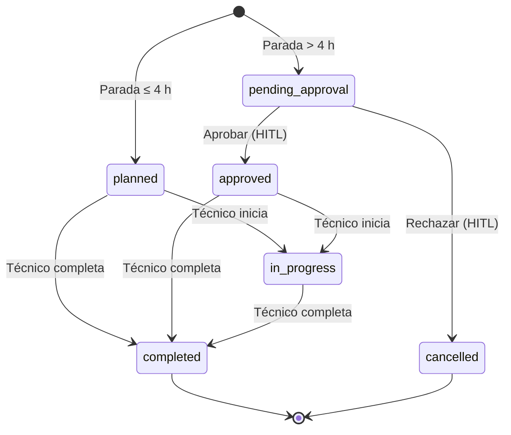

# Manual de usuario — MaintainPredict AI

Guía de uso de la plataforma para quien trabaja con ella: supervisores, planificadores, administradores y técnicos
de mantenimiento. Explica qué hace cada pantalla, quién puede hacer qué y cómo se recorre una orden desde que el
modelo detecta un riesgo hasta que el técnico la cierra.

> **Convención.** Lo que aparece entre comillas es el **texto literal** que verás en pantalla. Los nombres de
> estados y permisos van en `monoespaciado`.
>
> **Antes de empezar:** si la aplicación aún no está instalada, sigue `docs/MANUAL_INSTALACION.md`. Este manual
> asume que ya está funcionando y que tienes una cuenta.

---

## 1. Acceso

### 1.1 Iniciar sesión

1. Abre la aplicación (en desarrollo, `http://localhost:3000`).
2. En la tarjeta `Iniciar sesión` introduce `Email` y `Contraseña`.
3. Pulsa `Acceder` (mientras envía, el botón dice `Accediendo…`).

Si las credenciales son correctas:

- Un **técnico** va directamente a la app móvil (`/technician`).
- El resto de roles va a `/dashboard`, o a la página que intentaba abrir antes de que el sistema le pidiera
  identificarse.

Si fallan, verás el mensaje de error sobre el formulario. El sistema **no distingue** entre «el email no existe»,
«la cuenta está desactivada» y «la contraseña es incorrecta»: siempre responde lo mismo, a propósito.

> **Cuentas de demostración:** `admin@mp.ai`, `supervisor@mp.ai`, `planner@mp.ai`, `tec1@mp.ai` y `tec2@mp.ai`,
> todas con `Password123!`. En la pantalla de login vienen precargadas las de administrador. **No las uses con
> datos reales.**

### 1.2 Sesión y cierre

- La sesión dura **8 horas**; se renueva sola mientras haya un token de refresco válido (hasta 7 días).
- Para salir: menú `Cuenta` (abajo a la izquierda) → `Cerrar sesión`.
- En la app del técnico: botón `Salir` en la barra inferior.
- Cerrar sesión borra las cookies del navegador. **No invalida** un token que ya se hubiera copiado: si sospechas
  que te han robado la sesión, cambia la contraseña y avisa al administrador.

### 1.3 Cambiar mi contraseña

`Mi perfil` → tarjeta `Cambiar contraseña`:

1. Escribe tu `Contraseña actual`.
2. Escribe la `Nueva contraseña`; la lista de requisitos se marca en verde (`✓`) en cuanto se cumple cada uno.
3. `Repite la nueva contraseña`.
4. Pulsa `Cambiar contraseña`.

Requisitos (los mismos que valida el servidor):

- `Al menos 10 caracteres`
- `Como máximo 72 caracteres`
- `Al menos una letra mayúscula`
- `Al menos una letra minúscula`
- `Al menos un dígito`
- `Al menos un símbolo (no alfanumérico)`
- `Sin espacios en blanco`

Si las dos contraseñas no coinciden verás `Las dos contraseñas no coinciden.` y el botón permanece deshabilitado.
No existe recuperación automática: si olvidas la contraseña, un administrador debe restablecerla desde
`Usuarios`.

---

## 2. Roles y permisos

El rol determina qué ves y qué puedes hacer. No es solo cosmético: el servidor comprueba el permiso en cada
petición, así que escribir una dirección a mano no salta la restricción.

| Acción | Técnico | Supervisor | Planificador | Administrador |
|---|:--:|:--:|:--:|:--:|
| Ver dashboard, equipos, sensores, predicciones y órdenes | ✅ | ✅ | ✅ | ✅ |
| Ejecutar una predicción | — | ✅ | — | ✅ |
| Crear una orden (auto-plan) | — | ✅ | ✅ | ✅ |
| **Aprobar o rechazar** una orden (HITL) | — | ✅ | ✅ | ✅ |
| Completar una orden | ✅ (las suyas) | — | — | ✅ |
| Ver reportes y observabilidad | — | ✅ | ✅ | ✅ |
| Ver integraciones | — | ✅ | — | ✅ |
| Ver auditoría | — | — | — | ✅ |
| Gestionar usuarios | — | — | — | ✅ |
| Cambiar mi contraseña | ✅ | ✅ | ✅ | ✅ |

**En la práctica:**

- Si eres **técnico**, tu mundo es la app móvil: tus órdenes y sus checklists.
- Si eres **supervisor**, llevas la operación: predices, planificas, apruebas o rechazas, y lees informes.
- Si eres **planificador**, haces lo mismo salvo ver integraciones.
- Si eres **administrador**, además gestionas cuentas y auditas todo.

Cuando abras una página que tu rol no permite, el sistema te devolverá al área del técnico en lugar de mostrarte
un error. Si un enlace no aparece en el menú, es por permisos, no porque falte la página.

---

## 3. Navegación

### 3.1 Escritorio

Menú lateral izquierdo (`MaintainPredict`):

| Elemento | Qué encontrarás |
|---|---|
| `Dashboard` | KPIs, distribución de fallas y equipos críticos |
| `Equipos` | Listado y detalle de activos |
| `Sensores` | Sensores, umbrales y últimas lecturas |
| `Predicciones` | Riesgo por equipo y acción `Auto-plan` |
| `Órdenes` | Órdenes de mantenimiento y aprobación HITL |
| `Reportes` | Informe semanal descargable |
| `Observabilidad` | Métricas del modelo, KPIs y falsos positivos |
| `Mi perfil` | Cambio de contraseña |
| `Integraciones` (Administración) | Estado de ERP, SCADA, SMS y correo |
| `Auditoría` (Administración) | Bitácora de quién hizo qué |
| `Usuarios` (Administración) | Altas, roles y activación |

El bloque `Administración` solo aparece si tienes al menos uno de esos permisos. Arriba a la derecha verás una
insignia con tu rol (`technician`, `supervisor`, `planner`, `admin`).

### 3.2 App del técnico (móvil)

Barra inferior fija:

| Elemento | Destino |
|---|---|
| `Órdenes` | Tus órdenes asignadas |
| `Checklists` | Tus órdenes pendientes de ejecutar |
| `Escritorio` | Vista de escritorio |
| `Salir` | Cerrar sesión |

---

## 4. Pantallas

### 4.1 Dashboard (`/dashboard`)

**Qué muestra.** Cuatro tarjetas y dos secciones, con refresco automático cada minuto:

| Tarjeta | Contenido | Objetivo que se muestra |
|---|---|---|
| `Paradas evitadas` | Horas de parada evitadas | `objetivo −60%` |
| `Ahorro estimado` | Euros ahorrados | `objetivo −30%` |
| `Precisión del modelo` | Porcentaje con un decimal | `objetivo 85%` (en ámbar si no se alcanza) |
| `Disponibilidad` | Porcentaje con un decimal | `objetivo 99.5%` (en ámbar si no se alcanza) |

Debajo, cuatro contadores clicables: `Equipos caídos`, `Alertas 7 días`, `Órdenes abiertas` y
`Pendientes de aprobar`. Los dos primeros llevan un icono de alerta cuando el valor es mayor que cero.

- `Distribución de probabilidad de falla`: barras agrupadas en `0–30%`, `30–50%`, `50–70%`, `70–90%` y `90–100%`.
- `Equipos críticos`: hasta 12 equipos con su ubicación y criticidad; cada uno enlaza a su ficha.

**Qué puedes hacer.** Leer y navegar. No hay filtros ni exportación en esta pantalla.

**Ten en cuenta.** `Equipos críticos` se ordena por **severidad real** (primero `critical`, luego `high`, `medium`
y `low`), no alfabéticamente. Para ver el listado completo con filtros, usa `Equipos`.

---

### 4.2 Equipos (`/equipment`)

**Qué muestra.** Tabla paginada (20 por página) con: `ID`, `Nombre`, `Tipo`, `Ubicación`, `Criticidad`,
`Estado` y `EUR/h parada`.

**Filtros.**

- Buscador `Buscar por nombre…`.
- `Criticidad (todas)`: `critical`, `high`, `medium`, `low`.
- `Estado (todos)`: `operational`, `maintenance`, `down`, `retired`.

Cualquier cambio de filtro vuelve a la primera página. Abajo verás `Página X de Y · N equipos` y los botones
`Anterior` / `Siguiente`.

**Qué puedes hacer.** Abrir la ficha de un equipo pulsando su nombre. **No** hay alta, edición ni borrado desde la
interfaz.

**Para priorizar.** Filtra por `critical` para inspecciones y por `down` para actuar de inmediato.

---

### 4.3 Detalle de equipo (`/equipment/:id`)

**Qué muestra.**

- Cabecera con `Tipo`, `Ubicación`, `Criticidad`, `Estado`, `Coste parada` (€/h) e `Instalación`.
- `Lecturas de sensores`: gráfico de líneas con una serie por sensor (`{tipo}#{id}`), hasta 200 lecturas.
- `Últimas predicciones`: hasta 5, con componente, fecha y probabilidad. En rojo si supera el 70 %.
- Si no hay predicciones: `Sin predicciones registradas.`

**Qué puedes hacer.** Consultar. Para actuar sobre el equipo, ve a `Predicciones` y usa `Auto-plan`.

**Ten en cuenta.** Cada serie se acompaña de dos **líneas discontinuas del mismo color**: el mínimo y el máximo
configurados en su sensor. Si un sensor no tiene umbrales definidos, no se dibuja ninguna.

---

### 4.4 Sensores (`/sensors`)

**Qué muestra.** Tabla paginada (20 por página) con `ID`, `Equipo`, `Tipo`, `Unidad`, `Umbral mín.`,
`Umbral máx.`, `Estado` y una acción.

**Filtros.**

- `Tipo (vibración, temperatura…)`.
- `Todos los estados` → `active`, `inactive`, `maintenance`.
- `ID de equipo` (solo dígitos).

**Ver lecturas.** Pulsa `Ver lecturas` en una fila: se despliega una tabla con `Fecha`, `Valor` y `Calidad`
(las últimas 50). El botón cambia a `Ocultar`. Si no hay datos:
`Sin lecturas registradas para este sensor.`

**Dar de alta un sensor** (solo supervisor y administrador). Botón `Nuevo sensor` → diálogo `Alta de sensor`:

| Campo | Nota |
|---|---|
| `ID de equipo` | Obligatorio; debe existir |
| `Tipo` | Obligatorio, mínimo 2 caracteres (p. ej. `vibration`) |
| `Unidad` | Opcional (p. ej. `mm/s`) |
| `Estado` | `active`, `inactive` o `maintenance` |
| `Umbral mínimo` / `Umbral máximo` | Opcionales; el mínimo debe ser menor que el máximo |

Al guardar: `Sensor creado`. Si algo falla: `No se pudo crear el sensor` con el motivo.

**Para interpretar.** Un sensor `inactive` no alimenta al predictor: un equipo puede parecer sano por falta de
datos, no porque lo esté. Usa `maintenance` cuando el sensor esté temporalmente fuera de servicio por una
intervención; sus lecturas tampoco deben alimentar al predictor.

---

### 4.5 Predicciones (`/predictions`)

**Qué muestra.** Tabla paginada (20 por página), ordenada por probabilidad descendente, con `ID`, `Equipo`,
`Componente`, `Probabilidad`, `Modelo`, `Fecha` y `Acción`. Se refresca cada 30 segundos.

**Filtro.** Control `Umbral` (de 0 % a 100 %, en pasos de 5 %). Solo se aplica si es mayor que 0.

**Auto-plan.** El botón `Auto-plan` aparece solo si tienes permiso para crear órdenes (supervisor, planificador o
administrador). Al pulsarlo:

- Se crea una orden a partir de la predicción.
- Verás `Orden #N creada`, con la descripción `Requiere aprobación HITL.` o `Asignada al técnico.`
- La lista se refresca; **no** te lleva a la orden.

Si falla: `No se pudo planificar` con el motivo.

**Cómo leer la probabilidad.** Por encima del 70 % la predicción se considera **alerta** (el sistema la marca como
`alert`). El umbral del control solo filtra lo que ves; no cambia la alerta.

---

### 4.6 Detalle de predicción (`/predictions/:id`)

Esta es la pantalla para **entender** por qué el modelo decidió lo que decidió. Contiene:

1. **Cabecera:** `Predicción #N · {equipo}`, insignia `alerta` si aplica, versión del modelo, y una fila con
   `Probabilidad de falla`, `Componente`, `Ventana` (días), `Fecha` y `Ubicación y criticidad`.
2. **`Explicabilidad`:** el texto del agente. Si no hay: `Sin explicación registrada para esta predicción.`
   El desplegable `Ver features` muestra el JSON técnico.
3. **`Peso de cada señal`:** barras ordenadas por importancia (valor absoluto). Cuanto más larga, más pesó esa
   señal. Si el modelo no devolvió pesos: `El modelo no devolvió pesos por señal para esta predicción.`
4. **`Lecturas que entraron al modelo`:** para cada señal, el valor, el máximo y una barra de posición relativa
   (verde → ámbar). Si no hay: `No se registraron lecturas para esta predicción.`
5. **`Documentación consultada (RAG)`:** manuales y normativa citados, con su similitud. Si no hay:
   `No se recuperó documentación para esta predicción.`
6. **`Órdenes derivadas`:** tabla con `Orden`, `Programada`, `Técnico`, `Prioridad`, `Estado`, `Parada` y `HITL`.
   Si no existe ninguna, verás `Todavía no hay ninguna orden de mantenimiento para esta predicción.` y el botón
   `Generar orden (auto-plan)` (si tienes permiso).

**Qué puedes hacer.** Generar la orden si aún no existe. Si ya existe una, el botón desaparece para evitar
duplicados.

> **Limitación:** una orden **rechazada** también cuenta como «ya existe», así que no podrás regenerarla desde
> aquí. Para rehacerla, pide a un administrador que la cree por otra vía o espera a la corrección (ver §9).

---

### 4.7 Órdenes (`/orders`)

**Qué muestra.** Tabla paginada (20 por página), con refresco cada 30 segundos: `ID`, `Equipo`, `Programada`,
`Técnico`, `Prioridad`, `Estado`, `Parada` y `Acción`.

**Filtro.** `Todos los estados` → `pending_approval`, `approved`, `planned`, `in_progress`, `completed`,
`cancelled`.

**Aprobar desde el listado.** Si una orden está en `pending_approval` y tienes permiso, verás el botón `Aprobar`.
No pide confirmación: aprueba directamente. Para decidir con contexto (o para rechazar), entra en la ficha.

**Qué significan las columnas.**

- `Parada`: horas estimadas de parada. Es lo que dispara el HITL cuando supera 4 h.
- `Prioridad`: `low`, `medium`, `high`, `critical`.
- `Estado`: ver §5.

---

### 4.8 Detalle de orden (`/orders/:id`)

**Qué muestra.**

| Campo | Detalle |
|---|---|
| `Equipo` | Enlace al activo y su criticidad |
| `Técnico` | Nombre y teléfono, o `sin asignar` |
| `Programada` | Fecha y hora, o `—` |
| `Parada estimada` | Horas |
| `Repuestos` | `SKU×cantidad`, separados por comas |
| `Predicción de origen` | Enlace, componente y probabilidad |
| `Aprobada por` | Nombre, solo si se aprobó |
| `Notas` | Texto libre, incluido el motivo de un rechazo |

**Banners.**

- Si llegas desde el correo HITL (`?decision=approve|reject`) y la orden sigue pendiente, verás un aviso que
  empieza por `Has llegado desde el email de aprobación HITL…`. **El enlace no decide nada**: solo te trae aquí.
- Si la orden fue rechazada: `Orden rechazada.` `No se ejecutará. El motivo y quién la rechazó están en las notas,
  y la decisión queda registrada en la auditoría.`

**Aprobación HITL.** Si la orden está en `pending_approval` y tienes permiso, aparece la tarjeta
`Aprobación HITL` con dos botones:

- `Aprobar orden`.
- `Rechazar orden` (rojo).

Al rechazar se pide confirmación:

```
¿Rechazar la orden #N?

No se ejecutará: la orden quedará cancelada, conservará la predicción que la originó y tu nombre en las notas.
```

Si aceptas: la orden pasa a `cancelled`, **no** se firma como aprobada, se añade tu nombre y la fecha a las notas y
se registra `reject_order` en auditoría. Si cancelas el diálogo, no pasa nada.

**Completar orden.** Visible para `planned`, `approved` e `in_progress` si tienes permiso. Incluye:

- `Notas de intervención…`.
- `URL de foto (o subir en App Técnico)` + `Añadir`.
- Casilla `No se encontró falla real (marcar como falso positivo)`.
- Botón `Marcar como completada`.

Al marcarla, la orden pasa a `completed` y queda cerrada. Si marcas la casilla, esa predicción cuenta como falso
positivo en `Observabilidad`.

---

### 4.9 Reportes (`/reports`)

**Qué muestra.** El informe **semanal** (ventana fija de los últimos 7 días):

- `Órdenes por estado (fecha inicio → fecha fin)`.
- `Top equipos en riesgo` con su probabilidad máxima.
- `Métricas del modelo`.

**Descargas.**

| Botón | Formato |
|---|---|
| `Descargar PDF` | PDF |
| `Descargar Excel` | XLSX |
| `Descargar Word` | DOCX |

**Qué puedes hacer.** Descargar. No hay selector de fechas ni filtros en pantalla: la ventana la fija la API.

---

### 4.10 Observabilidad (`/observability`)

**Qué muestra.**

- Selector de ventana: `7 días`, `30 días`, `90 días` (por defecto 30).
- Tarjetas `Precisión`, `Recall`, `F1` y `AUC`, con umbrales (`≥ 85%`, `> 0.7`, `> 0.75`, `> 0.85`).
- `Falsos positivos (riesgo 28)`: tasa frente al objetivo `≤ 10%`, con `Predicciones > 0.70`,
  `Verdaderos positivos`, `FP automáticos` y `FP manuales`.
- Gráficos `Precisión del modelo` (con línea `Objetivo 85%`) y `Disponibilidad de planta`.

**Sincronizar ahora.** Recalcula métricas y escanea datos sucios. Al terminar: `Métricas sincronizadas`.

**Importante.** La sincronización usa siempre **7 días**, independientemente de la ventana seleccionada; y los
falsos positivos se calculan sobre 7 días. Es una limitación conocida, no un error de tu filtro.

---

### 4.11 Integraciones (`/integrations`)

**Qué muestra.** El estado en vivo de cuatro adaptadores:

| Nombre | Qué comprueba |
|---|---|
| `ERP (repuestos y catálogo)` | Que el ERP responde |
| `SCADA (lecturas en vivo)` | Que el SCADA responde |
| `SMS (avisos al técnico)` | Que la pasarela SMS responde |
| `Email (reportes y notificaciones)` | Que el SMTP responde |

Cabecera: insignia `modo mock` o `modo real`, resumen `Adaptadores correctos` (`X de Y`), `Con fallo` y
`Latencia máxima`. Tabla con `Integración`, `Adaptador`, `Modo`, `Estado`, `Latencia` y `Comprobado`.

**Qué puedes hacer.** `Volver a comprobar` (se refresca solo cada 60 s). No se editan credenciales desde aquí.

**Cómo interpretar.** `con fallo` en modo real apunta a credenciales o al endpoint externo; en modo `mock`, a que
falta levantar el contenedor correspondiente. Una latencia alta es del sistema externo, no de la aplicación.

---

### 4.12 Auditoría (`/audit`)

Solo administradores.

**Qué muestra.** La bitácora inmutable: `Fecha y hora`, `Usuario`, `Acción`, `Módulo`, `Entidad` e `IP`.
Paginación de 25.

**Filtros.** Módulo (`auth`, `equipment`, `kb`, `orders`, `predictions`, `reports`, `sensors`, `users`), acción
(login, logout, `login_failed`, alta/aprobación/rechazo/cierre de orden, predicción, sensores, usuarios, lectura de
informes, ingesta) y fecha (`Últimas 24 h`, `Últimos 7 días`, `Últimos 30 días`).

**Para qué sirve.** Detectar anomalías: picos de `login_failed`, aprobaciones o cierres fuera de turno, o cambios
de rol. Es la prueba de quién hizo qué.

---

### 4.13 Usuarios (`/users`)

Solo administradores.

**Qué muestra.** Tabla paginada (20) con `ID`, `Nombre`, `Email`, `Rol`, `Teléfono`, `Estado`, `Último acceso` y
`Acciones`. Los filtros son `Nombre o email`, `Todos los roles` y `Todos` / `Solo activos` / `Solo desactivados`.

**Qué puedes hacer.**

- **Cambiar el rol** con el desplegable de la fila (se guarda al instante).
- **Activar / desactivar** con el botón de la fila. Desactivar impide el login pero **conserva** el histórico.
- **Restablecer la contraseña** con `Contraseña`: escribe la nueva (con la lista de requisitos) y `Guardar`.
  Avísala por un canal seguro: la sesión anterior sigue válida hasta que caduque.
- **Crear un usuario** con `Nuevo usuario`: `Email`, `Nombre completo`, `Rol`, `Teléfono (opcional)` y
  `Contraseña inicial`.

**Restricciones de seguridad.** No puedes desactivarte a ti mismo ni cambiarte el rol; para eso hace falta otro
administrador. **No se borran usuarios**: se desactivan, para no romper las órdenes ni la auditoría que los
referencian.

---

## 5. Ciclo de vida de una orden



| Estado | Significado | Quién lo provoca |
|---|---|---|
| `planned` | Orden propuesta, sin necesidad de aprobación | Auto-plan o alta manual con parada ≤ 4 h |
| `pending_approval` | Bloqueada esperando decisión humana | Parada estimada **> 4 h** (estricto) |
| `approved` | Autorizada; el técnico puede ejecutarla | Supervisor, planificador o admin |
| `in_progress` | En ejecución | El técnico, con `Iniciar intervención` (desde `planned` o `approved`) |
| `completed` | Cerrada, con notas y fotos | Técnico (sus órdenes) o admin |
| `cancelled` | Rechazada; no se ejecutará | Supervisor, planificador o admin |

**Reglas que conviene saber:**

- El umbral de HITL es **4 horas estrictas**: 4,0 h no lo activa; 4,1 h sí.
- Una orden `planned` **no** se puede aprobar: no lo necesita. Puede ir a `in_progress` (si el técnico la
  inicia) o directa a `completed`.
- `in_progress` es **opcional**: sirve para dejar constancia de que la intervención empezó. Completar sin haber
  iniciado sigue siendo válido.
- Solo se aprueba o rechaza desde `pending_approval`. En cualquier otro estado, la API responde **409**.
- `completed` y `cancelled` son terminales: no se reabren.
- Un técnico solo puede cerrar **sus** órdenes. Si intenta cerrar la de otro, recibe `403`.
- Completar una orden ya cerrada devuelve `La orden ya se encuentra cerrada`.

---

## 6. El HITL, paso a paso

**HITL** (*Human-In-The-Loop*) es la aprobación humana obligatoria para órdenes cuya parada estimada supera 4 h.

1. El modelo detecta riesgo y el planner propone una orden.
2. Si la parada estimada es **> 4 h**, la orden nace en `pending_approval` y **no** se avisa al técnico.
3. n8n envía un correo a `SUPERVISOR_EMAIL` con **dos botones**: aprobar y rechazar. El correo no decide nada:
   ambos enlaces abren `/orders/:id` y exigen iniciar sesión con permiso `orders:approve`.
4. Ya dentro, revisas el contexto (equipo, predicción, repuestos, parada) y eliges:
   - `Aprobar orden` → estado `approved`, se firma `approved_by`/`approved_at`, se audita `approve_order` y se
     avisa al técnico.
   - `Rechazar orden` → confirmación → estado `cancelled`, **sin** firma de aprobación, con tu nombre y el motivo
     en las notas, y auditoría `reject_order`.
5. La ejecución de n8n que esperaba la decisión se reanuda y termina.
6. Si pasan **30 minutos** sin decisión, la espera caduca: n8n envía el correo de expiración y la orden deja de
   poder resolverse desde ese enlace.

> Si la orden ya no está `pending_approval` (porque caducó o alguien la resolvió), la API responde **409** y la
> interfaz te lo dice. No es un fallo: es la protección contra dos decisiones simultáneas.

---

## 7. App del técnico

### 7.1 `Órdenes` (`/technician`)

Muestra las órdenes **asignadas a ti** (hasta 50) con equipo, ubicación, fecha programada, estado y notas.
Se refresca cada 30 segundos. Si no tienes ninguna: `No tienes órdenes asignadas.`

Pulsa `Abrir checklist` para desplegar la orden. Si la orden está `planned` o `approved`, verás además el botón
`Iniciar intervención`: al pulsarlo la orden pasa a `in_progress` y queda constancia en la auditoría
(`start_order`) de que el trabajo ha empezado. Cuando ya está en curso, en lugar del botón aparece `En ejecución`.

### 7.2 Checklist

Seis pasos, con contador `N/6 pasos completados`:

1. `Bloqueo y etiquetado (LOTO) aplicado`
2. `Inspección visual sin anomalías`
3. `Vibración medida y registrada`
4. `Temperatura medida y registrada`
5. `Lubricación verificada`
6. `Repuestos sustituidos según orden`

Añade `Notas adicionales…` si hace falta. El botón `Completar orden` permanece **deshabilitado** hasta marcar los
seis pasos. Al pulsarlo, la orden pasa a `completed`.

### 7.3 Adjuntar foto

Etiqueta `Adjuntar foto`; abre la cámara del móvil (`capture="environment"`) o el selector de archivos. Límites:
**5 MB** y solo imágenes. Si el archivo no vale: `Solo imágenes` o `Máximo 5 MB`.

> **Cómo funciona:** al elegir la foto se sube al servidor y queda **pendiente**; verás
> `N foto(s) adjunta(s). Se enviarán al completar la orden.` Solo se adjunta de verdad cuando pulsas
> `Completar orden`. Subir una foto **no** cierra la orden.

### 7.4 `Checklists` (`/technician/checklists`)

Muestra solo tus órdenes abiertas (`planned`, `approved`, `in_progress`). Si no queda ninguna:
`No tienes checklists pendientes: no queda ninguna orden por ejecutar.`

---

## 8. Preguntas frecuentes

**No veo `Reportes`, `Observabilidad`, `Integraciones`, `Auditoría` ni `Usuarios`.**
Es por tu rol. El menú se filtra por permisos; la tabla de §2 dice quién ve qué.

**Soy técnico y no puedo aprobar una orden.**
Correcto: `orders:approve` es de supervisor, planificador y administrador. Tú ejecutas, no autorizas.

**¿Por qué mi orden está en `pending_approval` y el técnico no ha recibido nada?**
Porque la parada estimada supera 4 h y necesita aprobación humana. Hasta que alguien decida, no se notifica al
técnico.

**Rechacé una orden, ¿puedo volver a planificarla?**
Sí. Desde la ficha de la predicción vuelve a aparecer `Generar orden (auto-plan)` en cuanto la única orden que
existía queda cancelada. La orden rechazada sigue visible en `Órdenes derivadas` con su motivo.

**¿Qué es un falso positivo y cómo lo marco?**
Una predicción de falla que resultó no ser real. Al completar la orden, marca
`No se encontró falla real (marcar como falso positivo)`. Eso alimenta la tasa de falsos positivos de
`Observabilidad`.

**¿Cómo sé por qué el modelo predijo esto?**
Abre el detalle de la predicción: `Explicabilidad`, `Peso de cada señal`, `Lecturas que entraron al modelo` y
`Documentación consultada (RAG)`.

**¿Puedo editar o borrar un equipo?**
No desde la interfaz. El alta y la edición existen en la API, pero la pantalla es solo de consulta.

**¿Puedo borrar un usuario?**
No: se desactiva. Así las órdenes y la auditoría conservan la referencia.

**Olvidé mi contraseña.**
No hay recuperación automática. Pide a un administrador que la restablezca en `Usuarios` → `Contraseña`.

**¿Cuánto dura la sesión?**
8 horas de acceso; el refresco puede mantenerte hasta 7 días. Al cerrar sesión se borran las cookies.

**Me sale un 404 al abrir una ficha.**
El id no existe o no es numérico. Las fichas de equipo, orden y predicción comprueban la existencia en servidor y
devuelven 404 de verdad, no una pantalla vacía.

**¿Dónde leo los correos en desarrollo?**
En MailHog: `http://localhost:8025`. En producción se envían por el SMTP configurado.

**¿Puedo aprobar desde el correo?**
No directamente. El botón te lleva a la ficha de la orden y allí decides con sesión iniciada. Es deliberado: un
enlace de correo no debe poder cerrar una orden por sí solo.

**El informe siempre cubre los mismos días.**
Sí: la pantalla muestra el informe semanal con ventana fija de 7 días. No hay selector de fechas.

**¿Para qué sirve `Iniciar intervención`?**
Marca la orden como `in_progress` para dejar constancia de que el trabajo ha empezado. Es opcional: puedes completar
directamente sin pulsarlo.

**Subí una foto y la orden no se cerró.**
Es lo correcto: la foto queda pendiente y se adjunta al pulsar `Completar orden`. Antes se cerraba sola, pero se
corrigió para no cerrar una orden sin el checklist.

---

## 9. Limitaciones conocidas

Se listan para que no las confundas con un error tuyo. **Todas son decisiones de alcance**, no defectos: los
defectos que aparecieron al documentar el sistema están corregidos (`docs/PLAN_CIERRE_BRECHAS.md`).

| # | Qué ocurre | Impacto | Alternativa hoy |
|---|---|---|---|
| 1 | El informe es siempre de 7 días | No hay informes por rango | Exportar y filtrar fuera |
| 2 | `Sincronizar ahora` usa 7 días aunque elijas 30/90 | La ventana del botón no coincide | — |
| 3 | No se editan equipos ni se borran usuarios desde la UI | Gestión limitada | API / desactivar |
| 4 | La PWA no permite escribir sin conexión | Sin cobertura no se completa una orden | Hacerlo con conexión |

---

## 10. Glosario

| Término | Significado |
|---|---|
| **Auto-plan** | Acción que convierte una predicción en una orden de mantenimiento |
| **Criticidad** | Importancia del equipo: `low`, `medium`, `high`, `critical` |
| **Falso positivo** | Predicción de falla que no se correspondía con una falla real |
| **HITL** | *Human-In-The-Loop*: aprobación humana obligatoria (parada > 4 h) |
| **KPI** | Indicador clave: paradas evitadas, ahorro, precisión, disponibilidad |
| **Predicción** | Estimación de probabilidad de falla de un equipo en una ventana de días |
| **RAG** | Recuperación de documentación (manuales, normativa) para fundamentar la explicación |
| **Umbral** | Valor mínimo/máximo de un sensor, o filtro de probabilidad en la lista |
| **Ventana** | Número de días sobre los que se calcula una predicción |

---

## 11. Si algo no encaja

1. Comprueba tu rol (§2): la mayoría de «no puedo» son permisos.
2. Si es un error de la aplicación, anota la hora y la orden o predicción afectada: la auditoría permite
   reconstruir qué pasó.
3. Consulta `docs/TROUBLESHOOTING.md` para los fallos técnicos conocidos.
4. Si eres administrador, revisa `Auditoría` antes de reiniciar nada: la bitácora suele decir qué ocurrió y quién
   lo hizo.
