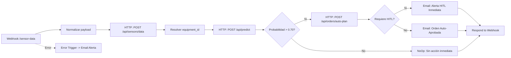
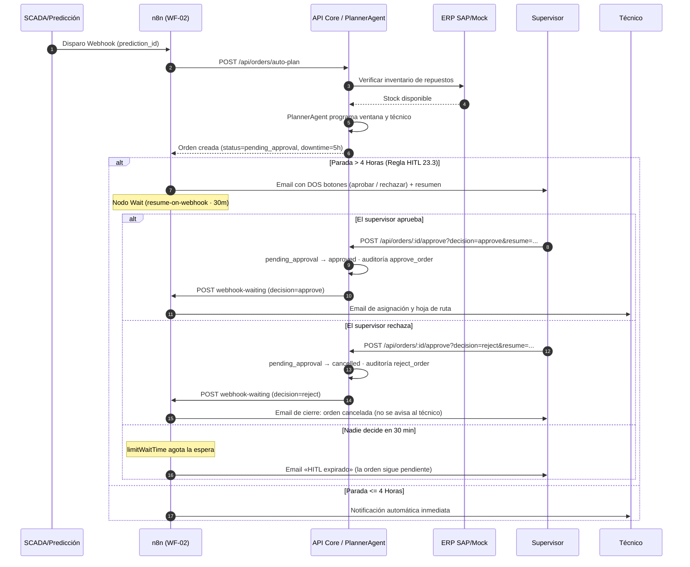
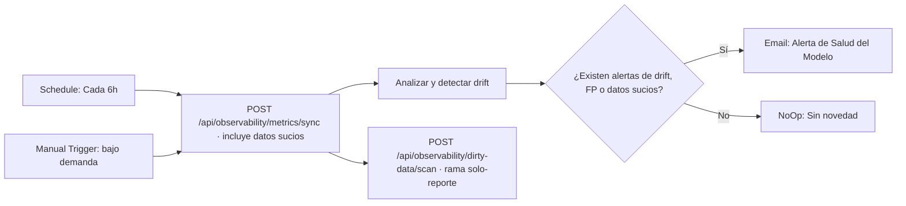

# Especificación de Workflows n8n — MaintainPredict AI

Este documento describe la arquitectura de automatización de procesos orquestada por n8n dentro del ecosistema MaintainPredict AI.

---

## 1. Arquitectura General de Orquestación

```mermaid
flowchart TD
    subgraph Ingestion ["1. Telemetría & Edge"]
        SCADA[SCADA / PLC / IoT]
    end

    subgraph Orchestrator ["2. Motor n8n"]
        WF1[WF-01: Sensor Intake]
        WF2[WF-02: Order Generation]
        WF3[WF-03: Weekly Report]
        WF4[WF-04: Metrics Sync]
    end

    subgraph Backend ["3. MaintainPredict Core (Next.js)"]
        API_Sensors["/api/sensors/data"]
        API_Predict["/api/predict"]
        API_Plan["/api/orders/auto-plan"]
        API_Reports["/api/reports/weekly"]
        API_Obs["/api/observability/*"]
    end

    subgraph Agents ["4. Agentes de IA & ML"]
        Predictor[PredictorAgent]
        Planner[PlannerAgent]
        MLService[FastAPI ML Service]
    end

    subgraph Human ["5. Supervisión (HITL)"]
        Supervisor((Supervisor Humano))
        Technician((Técnico de Campo))
    end

    SCADA -->|POST /sensor-data| WF1
    WF1 --> API_Sensors
    WF1 --> API_Predict
    API_Predict --> Predictor
    Predictor --> MLService
    WF1 -->|prob > 0.70| API_Plan
    API_Plan --> Planner

    WF2 --> API_Plan
    WF2 -->|downtime > 4h| Supervisor
    Supervisor -->|Aprueba o rechaza en la web| WF2
    WF2 -->|Notificación (solo si se aprueba)| Technician
    WF2 -->|Cierre si se rechaza| Supervisor

    WF3 -->|Cron lunes 08:00| API_Reports
    WF3 -->|Email resumen + PDF| Supervisor

    WF4 -->|Cron 6h| API_Obs
```

---

## 2. Detalle de Workflows

### WF-01: Sensor Intake & Predicción en Tiempo Real

El workflow **WF-01** recibe paquetes de lecturas telemétricas desde gateways IoT o servidores SCADA, los normaliza, los ingesta en la base de datos validando rangos operativos, y dispara inmediatamente la inferencia analítica si el equipo tiene mediciones críticas.



#### Reglas de Negocio Implementadas:
1. **Normalización Flexible**: Acepta objetos individuales (`{ sensor_id, value }`) o arrays masivos (`{ equipment_id, readings: [...] }`).
2. **Validación de Calidad**: Si la lectura viola límites físicos o tiene valores anómalos, el endpoint registra la calidad como `bad` o `suspect`.
3. **Disparador Agéntico**: Si `failure_probability > 0.70`, el pipeline se bifurca hacia el generador de órdenes automáticas.

---

### WF-02: Generación de Órdenes y Human-in-the-Loop (HITL)

El workflow **WF-02** se encarga de convertir predicciones de alta criticidad en órdenes de trabajo coordinadas. Integra consulta de repuestos en el ERP y disponibilidad de personal técnico.



#### Mecánica de Reanudación de Espera (Resume-on-Webhook):
- El nodo **Wait** genera una URL temporal de reanudación: `${N8N_WEBHOOK_BASE_URL}/webhook-waiting/${executionId}`.
  El nodo de código la deriva de `$execution.resumeUrl` reescribiendo el host a `N8N_WEBHOOK_BASE_URL`, porque la
  URL que calcula n8n apunta a su `WEBHOOK_URL` público (`localhost:5678`), no resoluble desde el contenedor web.
- ⚠️ El nodo Wait **no debe llevar `webhookSuffix`** (rompe el enrutado: n8n espera el `executionId` en la ruta)
  y su `httpMethod` debe ser **`POST`** (el valor por defecto, `GET`, hace que la reanudación devuelva
  *«does not contain a waiting webhook with a matching path/method»*).
- La pantalla de detalle de orden (`/orders/:id`) ofrece **dos acciones** a quien tenga `orders:approve`: `POST /api/orders/[id]/approve?decision=approve&resume=...` y `?decision=reject&resume=...`. El `?resume=` del email se reenvía desde el frontend (`window.location.search`); sin él la espera nunca se reanuda.
- El backend de Next.js efectúa la mutación en base de datos y dispara el callback HTTP hacia n8n para desbloquear el nodo y despachar la notificación correspondiente.
- **Decisión al aprobar**: `pending_approval → approved`, se firma `approved_by`/`approved_at` y se audita `approve_order`. Se notifica al técnico.
- **Decisión al rechazar**: `pending_approval → cancelled`, **no** se firma `approved_by` (quien rechaza no es quien aprueba) y se audita `reject_order`. Queda una traza legible en las notas de la propia orden y **no se avisa al técnico**, porque no hay nada que ejecutar. El rechazo es definitivo y por eso la UI pide confirmación explícita.
- `decision` se acepta por *query string* o por cuerpo JSON; sin ninguno de los dos se asume `approve` (compatibilidad con llamadas antiguas).
- **El enlace del correo no decide nada por sí solo**: abre la ficha de la orden y allí un usuario autenticado con `orders:approve` confirma. Así un correo reenviado no puede aprobar ni cancelar una parada por sí mismo.
- **Protección ante inacción (Timeout)**: Si transcurren 30 minutos sin respuesta humana (`limitWaitTime`), el
  workflow continúa por la rama negativa y notifica al supervisor con el aviso «HITL expirado» (la orden queda
  `pending_approval` para resolución manual prioritaria).
- Las tres salidas (aprobada, rechazada y expirada) se distinguen en un nodo de código que lee `decision` del cuerpo de la reanudación; el correo de cierre es distinto en cada caso, de modo que el supervisor no confunde un rechazo con una espera agotada.
- ⚠️ Los enlaces de los emails usan `PUBLIC_APP_URL` (navegador) y no `APP_BASE_URL` (red interna de Compose).
- ⚠️ Todo parámetro de n8n que contenga expresiones `{{ … }}` **debe empezar por `=`**. Sin ese prefijo n8n lo trata como texto literal y la plantilla viaja sin evaluar al correo (le pasó al cuerpo del email de rechazo durante la Fase I).

#### Consulta de repuestos en el ERP (no es un nodo de n8n)

La verificación de inventario **no** se implementa como nodo «ERP check-parts» del workflow, sino dentro del planner,
en el backend (`apps/web/lib/agents/planner.ts` → `tool_check_parts`). El agente dispone de esa herramienta y el
adaptador de integraciones (`ErpHttpAdapter`, `apps/web/lib/integrations/adapters/http-erp.ts`) degrada al catálogo
local (`LOCAL_PARTS_CATALOG`) si el ERP no responde, de modo que la planificación no se rompe por un proveedor caído.

El motivo de la decisión es de reparto de responsabilidades: **las reglas de negocio y los accesos a sistemas viven
en código** (versión, tests y auditoría), y n8n se queda con la orquestación y las notificaciones. Duplicar la consulta
como nodo daría dos fuentes de verdad para el mismo stock.

---

### WF-03: Reporte Ejecutivo Semanal

Se ejecuta todos los lunes a las 08:00 AM para compilar el estado global de la planta durante la semana anterior.

```mermaid
flowchart TD
    Cron[Schedule: Lunes 08:00] --> Win[Calcular ventana: Lun-Dom anterior]
    Manual[Manual Trigger: bajo demanda] --> Win

    Win --> JSON[HTTP GET /api/reports/weekly (JSON)]
    Win --> XLSX[HTTP GET /api/reports/weekly?format=xlsx]
    XLSX --> FS_XLSX[Guardar en /data/reports/*.xlsx]

    JSON --> LLM[LLM: resumen ejecutivo]
    LLM --> Fallback[Fallback sintético si falla el LLM]
    Fallback --> PDF[HTTP GET /api/reports/weekly?format=pdf]
    PDF --> FS_PDF[Guardar en /data/reports/*.pdf]
    FS_PDF --> Alerts[Generar alertas destacadas · propaga el binario PDF]
    Alerts --> Email[Email Supervisor con HTML y adjunto PDF]
```

> La cadena principal es lineal (`JSON → LLM → resumen → PDF → alertas → email`) para que ningún nodo referencie
> a otro que no se haya ejecutado y el binario del PDF llegue al adjunto; la rama XLSX solo persiste el fichero.
> El nodo LLM usa `onError: continueRegularOutput`, así que un fallo del proveedor no rompe el workflow.
> Requiere el volumen `reports_data` (preparado por el one-shot `reports-init`).

---

### WF-04: Sincronización de Métricas y Detección de Drift

Ejecutado periódicamente cada 6 horas para monitorizar la fiabilidad del modelo de Machine Learning y la calidad de los datos recopilados.



> El endpoint de sync ya devuelve el escaneo de datos sucios (`includeDirtyScan: true`), así que el análisis lee
> `dirty` de su propia respuesta; el nodo «escaneo datos sucios dedicado» es una rama **paralela** solo-reporte
> (no alimenta al análisis, para no depender de que se haya ejecutado).

---

## 3. Verificación

El flujo HITL tiene una prueba de extremo a extremo propia, que dispara WF-02 de verdad, lee el correo que recibiría
el supervisor en MailHog, resuelve la decisión por la misma API que usa la interfaz y comprueba el rastro completo
(estado de la orden, notas, auditoría, correo de cierre y ejecución de n8n):

```bash
node scripts/e2e-hitl.mjs approve    # rama aprobada
node scripts/e2e-hitl.mjs reject     # rama rechazada (orden → cancelled)
```

> La prueba crea órdenes reales (es la única forma de disparar el HITL) y no las borra: quedan como datos de demo.
> Lee los correos con `fetch` sobre la API de MailHog y descodifica *quoted-printable*, porque el HTML viaja
> codificado (`=` se serializa como `=3D`) y un `grep` directo de la URL no encontraría nada.

El resto de la validación de n8n se apoya en `bash scripts/smoke-test.sh` (API, reportes, RBAC, token interno) y
`bash scripts/check-links.sh` (navegación y matriz de permisos por rol).

---

## 4. Pendiente en esta fase

| Tarea | Por qué no se cierra aquí |
|---|---|
| **Idempotencia real de WF-04** (I.3) | Depende de H.5: hoy el *sync* es idempotente por ventana temporal, no por identificador de ejecución. |
| **Alerta de reentrenamiento** cuando la tasa de falsos positivos supera el 10 % en 7 días (I.4) | Depende de F.4: hasta que exista la métrica de FP a 7 días (y el reentrenamiento) no hay señal que alertar. |

Ambas se documentan como bloqueadas, no como hechas: se retoman al cerrar sus fases de origen para no dejar
comportamiento sin verificar.
